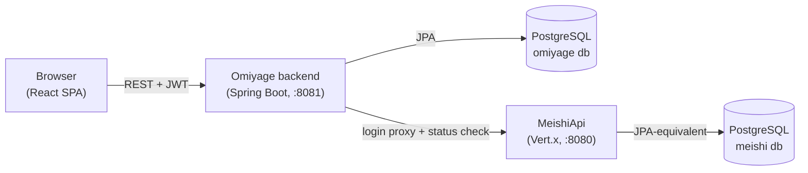
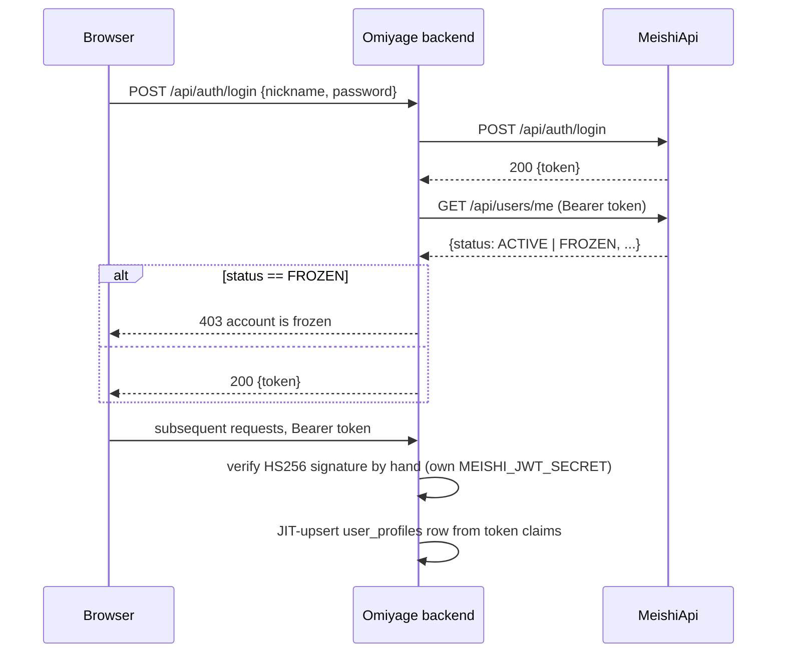
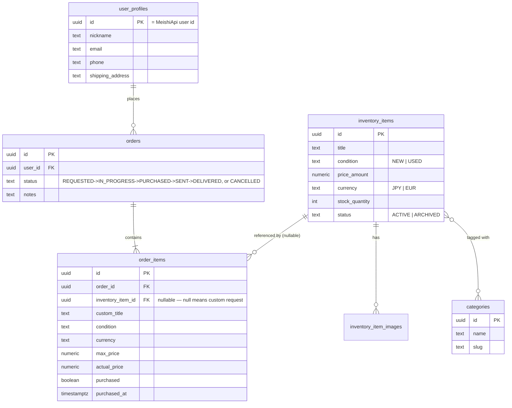

# Omiyage — Architecture Report

Friends-and-family utility for browsing an inventory of stuff and requesting things to be bought/shipped from Japan. Two apps: `backend` (Kotlin + Spring Boot 4, Java 21) and `frontend` (React 18 + TypeScript + Vite). User identity and auth are delegated entirely to the existing **MeishiApi** service.

## System overview



The frontend never talks to MeishiApi directly — login is proxied through the Omiyage backend (`POST /api/auth/login`) so the browser only ever has one API origin, and MeishiApi doesn't need CORS configured for a second frontend.

## Auth flow

MeishiApi is the source of truth for accounts (nickname, password, role). It issues HS256 JWTs signed with a shared secret (`MEISHI_JWT_SECRET`, must match between the two apps) containing `sub` (user UUID), `nickname`, and `role` (`USER`/`ADMIN`) claims — no expiry-independent revocation, no status claim.



Two deliberate choices worth flagging:

- **Frozen-account check happens once, at login**, not per-request — MeishiApi's JWT has no status claim, so a frozen account's existing token stays technically valid until it expires (24h) even though we reject it at the next login. Re-checking on every request would mean an extra HTTP call to MeishiApi per Omiyage request, which isn't worth it for a friends-scale tool.
- **Omiyage verifies JWTs by hand** (`security/JwtVerifier.kt`), not via a JWT library. jjwt (and most JWT libs) refuse to sign or verify HS256 with a key under 256 bits as a security policy — but MeishiApi's Vert.x-based signer has no such minimum and its dev-default secret is well under that. A library-based verifier would silently fail to validate perfectly legitimate MeishiApi tokens whenever the shared secret is short. The hand-rolled version (`javax.crypto.Mac`, constant-time signature comparison) matches Vert.x's actual behavior exactly.

I also added `GET /api/users/me` to MeishiApi (previously only `GET /api/users` existed, admin-only) — a `findById` on `UserRepository`, a handler, and a route registered ahead of the `/api/users*` admin-only wildcard block so any authenticated user (not just admins) can read their own record. This is what the login-proxy's frozen-check calls.

### Shared-secret coupling and rotation

`MEISHI_JWT_SECRET` here must equal MeishiApi's `JWT_SECRET`; both apps also share the admin account, so a leak in either compromises both. Outside the `dev`/`test` profiles the secret must be set, not the dev default, and at least 32 bytes. Only HS256 tokens are accepted (the header `alg` is checked).

Rotation without downtime:
1. Set `MEISHI_JWT_SECRET_PREVIOUS=<old>` (cluster secret key `meishi-jwt-secret-previous`, optional) and `MEISHI_JWT_SECRET=<new>` on Omiyage and deploy; tokens signed with either are accepted.
2. Switch MeishiApi's `JWT_SECRET` to `<new>` and deploy; new logins now use the new secret.
3. After the token lifetime (24h) has passed, unset `MEISHI_JWT_SECRET_PREVIOUS`.

Omiyage itself keeps accepting old-secret tokens until step 3, but MeishiApi verifies only its own secret: after step 2, calls Omiyage forwards to Meishi with an old token (profile endpoints, the account-status check on writes and admin calls) get 401 until the user logs in again.

The MeishiApi endpoints Omiyage depends on (`POST /api/auth/login`, `GET /api/users/me`, `PATCH /api/users/me/nickname`, `GET /api/users`, `GET /api/users/nicknames`; `PATCH /api/users/me` and `/password` are not yet covered) are pinned by `MeishiContractTest`. Moving to asymmetric signing (RS256 + JWKS) is the planned follow-up and would remove the shared secret.

## Image storage

Uploaded images are stored in PostgreSQL (`media` table: bytes, content type, uploader, size), not in object storage. Items reference them by key (`uploads/<uuid>.<ext>`) and `GET /api/images/uploads/{file}` serves them publicly.

## Data model

MeishiApi's `users` table has no email/phone/address fields — only nickname. Omiyage keeps a parallel `user_profiles` table keyed by the Meishi user UUID, JIT-created the first time a user hits `/api/users/me` or places an order.



Key design point: an `order_item` either references an existing `inventory_item` (buy-from-stock) **or** carries its own custom title/description/photo/condition (a "please go find me this" request) — enforced by a DB check constraint (`inventory_item_id IS NOT NULL OR custom_title IS NOT NULL`). Each item in an order has its **own** `purchased` flag and `actual_price`, settable independently, because — per your note — items in one request often get bought on different days. `orders.status` is a separate, admin-set field; it does not auto-derive from the items' purchased flags, to keep the state machine simple and admin-controlled.

## Backend module map

| Package | Responsibility |
|---|---|
| `security` | `JwtVerifier` (hand-rolled HS256 check), `JwtAuthenticationFilter`, `SecurityConfig`, `CurrentUser` helper |
| `config` | `MeishiProperties` (`@ConfigurationProperties`) |
| `user` | `UserProfile` entity/repo/service, JIT provisioning, `GET`/`PATCH /api/users/me` |
| `catalog` | `Category`, `InventoryItem` (+images, categories m2m), search/pagination, admin CRUD |
| `media` | images stored as `bytea` in the `media` table; `POST /api/images` upload, public `GET /api/images/{key}` |
| `order` | `Order`/`OrderItem`, create/list/detail, admin status + per-item purchased updates |
| `auth` | Login proxy to MeishiApi (`MeishiAuthClient`, `AuthService`, `AuthController`) |
| `web` | `PageResponse<T>` (slim pagination DTO), `GlobalExceptionHandler` (keeps error bodies as `{"error": "..."}` — same shape MeishiApi uses, so the frontend's one error-parsing path works against either backend) |

## API surface

| Method & path | Access | Purpose |
|---|---|---|
| `POST /api/auth/login` | public | proxy login to MeishiApi + frozen check |
| `GET/PATCH /api/users/me` | any user | own profile |
| `GET /api/categories` | any user | category list |
| `GET /api/inventory`, `GET /api/inventory/{id}` | any user | browse/search/paginate, ACTIVE only |
| `POST /api/orders`, `GET /api/orders/mine`, `GET /api/orders/{id}` | any user | create/list/view own orders |
| `POST /api/images` | any user | upload a photo, returns a bucket-relative key |
| `POST/PUT/DELETE /api/admin/inventory*`, `/api/admin/categories*` | ADMIN | catalog management |
| `GET /api/admin/orders`, `PATCH /api/admin/orders/{id}`, `PATCH /api/admin/orders/{id}/items/{itemId}` | ADMIN | order queue, status, per-item purchased |

## Frontend structure

`src/lib` (API client, JWT decode, media URL helper) · `src/store` (Zustand auth store, Bearer token in `localStorage` — same pattern as `meishiFrontend`) · `src/routes` (route guards: `RequireAuth`, `RequireAdmin`) · `src/api` (TanStack Query hooks per domain) · `src/pages` incl. `pages/admin` · `src/components` (`Pagination`, `OrderStatusBadge`, `Layout`).

Images: the backend stores/returns bucket-relative object keys only (not URLs), so swapping storage backends later doesn't touch stored data. The frontend builds display URLs itself as `${VITE_API_BASE_URL}/api/images/${key}` (the GET endpoint is public because img tags cannot send the JWT).

## Logging

Console output is JSON (logstash); MDC keys become fields. `LOG_LEVEL` sets the app level (default `INFO`), `SLOW_REQUEST_MS` the slow-request threshold (default 2000). Hibernate and Spring Security stay at `WARN`; never enable Hibernate SQL parameter logging.

| Logger | Content |
|---|---|
| `access` | One line per request: `requestId`, `method`, `route` (matched pattern or `unmatched`, never URI/query), `status`, `durationMs`, `userId` (UUID or `anonymous`), `role`. 2xx/3xx/4xx `INFO` (401/403/429 `WARN`), 5xx `ERROR`, probes `DEBUG`. |
| `slow` | `WARN slow_request` when `durationMs` exceeds the threshold. |
| `events` | Business events (`order_created`, `order_status_changed`, `shipment_combined`, `inventory_item_created`, `media_uploaded`, `combine_request_*`, ...): ids, counts and enums only. |
| `security` | `login_failed` (`nicknameHash`, `clientIp`), `login_rate_limited`, `account_status_blocked`. |
| `meishi.client` | One line per MeishiApi call: method, path, status, `durationMs`. `X-Request-Id` is forwarded. |

Never log: credentials/tokens (`Authorization`, `Cookie`, JWTs, passwords, secrets), request/response bodies, query strings, personal data (email, phone, address, names, notes, tracking numbers), submitted login names (use `nicknameHash`: first 8 hex of SHA-256 of the lower-cased name), file bytes, or request-derived values without validation. Client IPs only on authentication and rate-limit events. `SensitiveDataLoggingTest` fails if a canary value reaches any log event.

## Test strategy

| Layer | Backend | Frontend |
|---|---|---|
| Unit | `JwtVerifierTest`, `AuthServiceTest` (MockK) | `authStore.test.ts`, `guards.test.tsx`, `Pagination.test.tsx`, `OrderStatusBadge.test.tsx` |
| Web-slice / component | `@WebMvcTest` + MockMvc per controller, incl. 401/403 cases (springmockk) | RTL + MSW per page (`InventoryPage`, `OrderDetailPage`, `AdminOrdersPage`, ...) |
| Integration | Testcontainers Postgres (`*ServiceIntegrationTest` — search/pagination/category-filter, order creation + ownership + purchased-flag independence, profile JIT-sync), WireMock against the real MeishiApi HTTP contract (`AuthIntegrationTest`) | — |
| Full-stack slice | `FullFlowIntegrationTest` — real MockMvc + real Postgres, drives create-order-with-image → admin-marks-purchased → status-advance → user-sees-update over actual HTTP | — |
| E2E | — | Playwright (`e2e/critical-flow.spec.ts`) — same flow as the full-stack slice test but through the real browser-rendered UI, seeding throwaway MeishiApi accounts via its admin API per run |

**Current status**: 47/47 backend unit + web-slice tests pass, 36/36 frontend tests pass, both apps build clean. The Testcontainers-based integration tests, the full-stack slice test, and the Playwright e2e suite are all written and compile/type-check, but haven't executed yet — this sandbox's Docker Desktop isn't running. They need Docker up locally to actually run (see below); nothing about them is blocked on code.

## Running locally

```bash
# 1. infra deps (Postgres :5433) — NOT the apps themselves
docker compose up -d

# 2. backend (needs MeishiApi running separately on :8080 for login to work)
cd backend && ./gradlew bootRun

# 3. frontend
cd frontend && npm install && npm run dev
```

Copy `.env.example` to `.env` at the repo root first — `MEISHI_JWT_SECRET` must match whatever MeishiApi is configured with, or nothing will authenticate.

```bash
# backend tests
cd backend && ./gradlew test          # needs Docker for *IntegrationTest classes

# frontend tests
cd frontend && npm test               # vitest, no Docker needed
npm run test:e2e                      # needs docker-compose + backend + MeishiApi running,
                                       # plus E2E_MEISHI_ADMIN_NICKNAME/PASSWORD env vars
                                       # pointing at a pre-existing seeded Meishi admin
```

## Deviations from the original plan worth knowing about

- **No separate "display name" override** in the user profile — nickname is always synced live from MeishiApi's JWT claim. The original plan mentioned an override; dropping it avoids two sources of truth for the same field, and users can already rename themselves in Meishi.
- **`GET /api/users/me` added to MeishiApi** (not originally part of MeishiApi's surface) — needed for the frozen-account check and useful in general as MeishiApi previously had no self-service "who am I" endpoint at all, only an admin-only list.
- **Order status is fully admin-controlled**, not derived from item purchased-flags — simpler mental model, and matches "it might take a while to get each item" (some items done, order still "in progress" until the admin says otherwise).

## Open follow-ups

1. Run `./gradlew test` and `npm run test:e2e` once Docker Desktop is up, to get the integration/e2e suites actually executing (not just compiling).
2. MeishiApi has no self-registration — new friends still need an admin (on the Meishi side) to create their account slot first, same as before this project.
